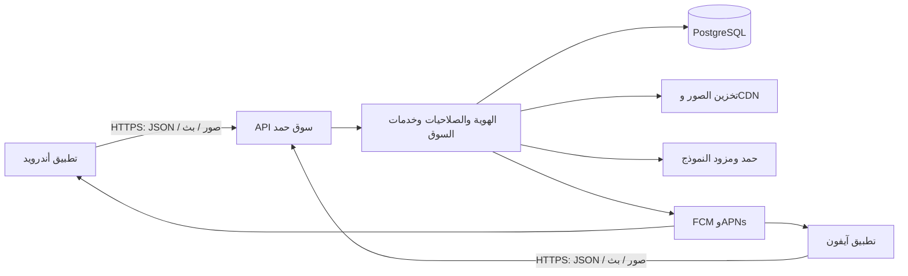

# بنية تطبيق سوق حمد لأندرويد وآيفون

تاريخ المراجعة والتحديث التنفيذي: 23 أكتوبر 2026 — النطاق: الكود المحلي في SmartStoreAI.

بدأت هذه الوثيقة تصميمًا مبنيًا على مراجعة المشروع قبل إنشاء تطبيق الجوال، ثم حُدثت بعد تنفيذ [mobile](../README.md). تميز الأقسام الآن ما نُفذ في المصدر عن أهداف التصميم والعمل المتبقي. أضيفت واجهات أصلية وbootstrap وقراءة الإعلان المملوك والتواصل وApple Native. أوامر التشغيل والنتائج التفصيلية في [README الجوال](../README.md) و[سجل التحقق](native-mobile-verification-2026-10-23.ar.md).

الحالة المتحققة: تثبيت الاعتماديات وفحص المصدر واختبارات النقل والسيرفر ومعاينة الواجهات نجحت، ونجح تصدير حزم JavaScript/Hermes لأندرويد وآيفون والويب. اكتمل Gradle `assembleRelease` بنجاح خلال 8 دقائق و45 ثانية، وأنتج [APK أندرويد تجريبيًا](../.data/native-souq-hamad-android-preview.apk) بتوقيع `CN=Android Debug` وتحقق apksigner ناجح. لم يُثبت أو يُشغّل على جهاز، ولم يُبنَ IPA أو تُختبر خدمات الدخول والإشعارات الفعلية. لم تُنشر إضافات السيرفر أو الحزم إلى المتاجر، ولم تتطلب هذه المراجعة قراءة الأسرار أو تغيير بيانات الإنتاج. المقترحات المتبقية موسومة صراحة في مواضعها، وليست كل إضافات التصميم الأصلي ما تزال غائبة.

## 1. القرار وطريقة عمل التطبيق

تطبيق مستقل بواجهات React Native وTypeScript، مع Expo development builds لتجميع الكود الأصلي وإدارة إمكانات الجهاز. الشاشة والتنقل والنماذج وعرض المحادثات تُبرمج داخل التطبيق. جميع عمليات السوق تُرسل إلى السيرفر مباشرة عبر HTTPS API.



لا يجلب التطبيق صفحات HTML، ولا يستخدم WebView أو Capacitor أو شاشات mobile-web. حزمة الإصدار تحتوي على الواجهات وملفاتها اللازمة؛ الاتصال مطلوب للبيانات الحية. لا يتصل الهاتف بقاعدة البيانات مباشرة، ولا يحمل مفاتيح قاعدة البيانات أو التخزين أو مزود النموذج.

يبقى API في مشروع Next.js الحالي؛ طلب `/api/marketplace/listings` يطلب بيانات JSON ولا يحمّل صفحة الموقع. يعيد التطبيق استخدام خدمات السوق وقاعدة البيانات عبر API، وأضيفت المسارات اللازمة للإقلاع والإعلان المملوك والتواصل والدخول الأصلي. وجود المسارات محليًا لا يعني نشرها على النطاق المحدد للتطبيق.

Expo هنا أدوات بناء ومكتبات أصلية. لا يتطلب تشغيل سوق حمد استخدام Expo Push Service أو استضافة بيانات السوق لدى Expo. يدعم React Native مكونات أصلية للنظامين؛ انظر [المكونات الأصلية](https://reactnative.dev/docs/intro-react-native-components) و[development builds](https://docs.expo.dev/develop/development-builds/introduction/).

## 2. حالة التنفيذ بعد المراجعة الأصلية

| الجزء | الموجود في الكود الحالي | ما بقي أو ما لم يثبت |
| --- | --- | --- |
| السوق | شاشات أصلية للبحث والفلاتر الأساسية والتفاصيل والمحرر وحالات الإعلان والصور | اكتمال الفلاتر التفصيلية وعرض المشابه حسب أهداف القسم 5، واختبارات الأجهزة |
| الحساب | Google وApple Native وBearer وتعديل الحساب وصورته وحذفه | إعدادات المزودين وتجربة الدخول على أجهزة، وجلسات أجهزة قابلة للإلغاء |
| إقرار الرسوم | API اتفاقية موقعة وواجهة قبول وروابط سياسات أصلية من bootstrap | التحقق من الإعدادات والإصدارات على السيرفر المستهدف |
| المحادثات | قائمة وتفاصيل أصلية وإرسال ومشاركة رقم وحظر وبلاغ وحذف | تجربة الجهاز والشبكة؛ طلب القراءة متوقف عند blur والخلفية في العميل |
| المتابعة | المفضلة وملف المعلن والتقييم والمتابعة وقائمة المتابعين وتنبيهات المشابه الموجودة | زر إنشاء متابعة مشابه من التفاصيل وقائمة المشابه غير منفذين في شاشة التفاصيل الحالية |
| العمولات | شاشة أصلية للسجلات وقيمة البيع وتعليمات الدفع والنسخ | تجربة الربط؛ لا توجد بوابة دفع إلكترونية جديدة |
| الإشعارات | عميل native tokens وتسجيل وإلغاء وتوجيه، وتفعيل يدوي من الإعدادات | تهيئة FCM/APNs واختبار التسليم على الأجهزة |
| التحديث اللحظي | عميل expo/fetch وإعادة اتصال ومزامنة وإيقاف بالخلفية | الناقل على السيرفر ما يزال محليًا للعملية؛ لا Redis event bus مطبق |
| حمد | واجهة أصلية وبث ومسودات ومساعدة، وتاريخ نصي محلي مشفر ومعزول | تجربة النموذج المباشر؛ لا مزامنة تاريخ بين الأجهزة |
| بناء الجوال | حزمة مستقلة Expo SDK 58 وReact Native 0.88؛ lint/types واختبارات وتصدير ناجح، وAPK أصلي تحقق توقيعه التجريبي | IPA وتوقيع المالك وتشغيل الأجهزة والمتاجر لم تتحقق |

فهرس المسارات الحالية كاملًا في [فهرس API](native-mobile-api-inventory.md). اكتشاف المسار لا يثبت نجاحه مع مزود خارجي أو جهاز فعلي. README وبعض التقارير تصف مراحل سابقة؛ المرجع في نطاق حمد هو التنفيذ الحالي و[hamad-role.md](hamad-role.md).

## 3. تنظيم المستودع المنفذ

بقي تطبيق الويب والسيرفر في موضعهما، وأُنشئت حزمة `mobile` مستقلة باعتماديات وlockfile وإعدادات فحص خاصة. الشجرة التالية تصف التنفيذ الفعلي. تقسيم `packages/contracts` و`packages/api-client` وworkspace موحد كان اقتراحًا في التصميم الأول، ولم يُطبق؛ العقود والعميل موجودان حاليًا داخل `../src/core`.

```text
SmartStoreAI/
  app/                         # الموقع وAPI الحالية
  agent/                       # خدمات السوق وحمد على السيرفر
  lib/                         # الخدمات الحالية؛ لا تستورد كاملة إلى الهاتف
  prisma/                      # قاعدة البيانات والمهاجرات

    package.json
    app.config.ts              # هوية التطبيق والصلاحيات وconfig plugins
    eas.json                   # ملفات development / preview / production
    tsconfig.json
    .npmrc                     # node-linker=hoisted لتقصير مسارات البناء على Windows
    pnpm-lock.yaml
    assets/                    # أصل الهوية؛ خط عربي محزم من حزمة الخط
    src/
      app/                     # مسارات Expo Router؛ ملفات تركيب خفيفة
        _layout.tsx
        (tabs)/                # الرئيسية، إعلاناتي، محادثاتي، المفضلة، حسابي
        listings/[listingId].tsx
        sellers/[sellerId].tsx
        conversations/[conversationId].tsx
        auth.tsx               # الإقرار وتسجيل الدخول
        create/                # اختيار يدوي أو مع حمد؛ المحرر والمعاينة
        account/               # الملف والصورة والمتابعة والحذف
        notifications.tsx
        commissions.tsx
        policies/[policyId].tsx
      features/                # كل ميزة: screens / components / queries / logic
        marketplace/
        listing-editor/
        seller/
        conversations/
        favorites/
        account/               # الحساب والمتابعة والسياسات
        assistant/
        notifications/
        commissions/
      core/
        api.ts                 # إعداد العميل والبيئة وتفسير الأخطاء وإلغاء الطلبات
        auth.tsx               # حالة الجلسة والتخزين الآمن
        bootstrap.ts           # كتالوج وسياسات وحدود وميزات السيرفر
        types.ts               # أنواع JSON المستعملة في التطبيق
        realtime.ts            # SSE وإعادة الاتصال وإبطال cache
        realtime-decoder.ts    # فك إطارات SSE وUTF-8
        push.ts                # tokens والقنوات وتوجيه الإشعارات
        media.ts               # التقاط الصور وتحويلها
        presentation.ts        # تنسيق العرض
      ui/                      # عناصر أصلية مشتركة وثيم وعربية وRTL
    tests/                     # native-transport ومعاينة browser-smoke
  .github/workflows/mobile.yml # فحص مستقل وتصدير حزم JavaScript
```

ثُبتت Expo 58 وReact Native 0.88 وReact 19.3 وفق توافق SDK. استُبعد `mobile` من فحص TypeScript وESLint الخاص بالجذر، وله فحص مستقل وCI مستقل. أصبح تثبيت حزمة الجوال بنمط pnpm `hoisted` لتقصير مسارات المكتبات الأصلية على Windows؛ أعقب تهيئة المسارات وCMake بناء APK ناجح بالفعل كما هو موثق في سجل التحقق. تبقى مراجعة Metro وحل React مهمة عند تغيير الاعتماديات.

باستخدام توليد المشاريع الأصلية، تكون إعدادات Android وiOS في app config وconfig plugins. تُولد مجلدات النظامين عند البناء؛ أي تعديل أصلي مخصص يصبح module/plugin محفوظًا في المصدر، مع التحقق من إعادة توليد المشروع دون فقده.

## 4. الطبقات ومسؤولياتها

| الطبقة | المسؤولية | التنفيذ الحالي |
| --- | --- | --- |
| واجهة المستخدم | مكونات أصلية، قوائم، صور، نماذج، تنقل | React Native وExpo Router |
| بيانات السيرفر | cache، pagination، تحديث الحالة بعد العمليات | TanStack Query وربطه بـAppState وSSE وإعادة الجلب |
| حالة محلية | الفلاتر، محرر الإعلان، المعاينة، التفضيلات | hooks/context؛ مخزن إضافي عند الحاجة فقط |
| HTTP | base URL مطلق، Bearer، timeout، abort، decoding | عميل واحد وأنواع JSON؛ OpenAPI والتحقق الشامل من DTO ما يزالان عملًا لاحقًا |
| هوية الجهاز | حفظ وإزالة رموز الجلسة | SecureStore باستخدام Keychain/Keystore |
| الوسائط | المعرض والكاميرا والتحويل والتصغير والرفع | ImagePicker وImageManipulator وعارض صور أصلي |
| البث | قراءة بروتوكول حمد وSSE السوق | expo/fetch مع decoder مستقل للسوق وAI SDK لحمد |
| الدفع الحالي | عرض العمولات وتعليمات السيرفر والنسخ | مكونات أصلية، دون اختراع بوابة دفع |

البيانات المالية والصلاحيات والملكية والحظر وقرارات الإشراف تظل حاسمة على السيرفر. التطبيق يعرض نتائجها ويمنع أخطاء الاستخدام، ولا يمنح نفسه صلاحية اعتمادًا على إخفاء زر.

مراجع الاختيارات: [التخزين الآمن](https://docs.expo.dev/versions/latest/sdk/securestore/)، [TanStack Query على React Native](https://tanstack.com/query/latest/docs/framework/react/react-native)، [دليل AI SDK للجوال والبث](https://ai-sdk.dev/docs/getting-started/expo).

## 5. الشاشات المنفذة وأهداف المطابقة المتبقية

| المجموعة | التنفيذ الحالي وحدوده |
| --- | --- |
| البداية | splash محلي واستعادة الجلسة وتصفح الضيف، مع حالات تحميل وأخطاء وإعادة محاولة |
| الرئيسية | البحث الحرفي والمدينة والفئة والسعر والحالة والترتيب الصحيح وpagination؛ فلاتر الخيارات/موديلات السيارات/السنة/الممشى موجودة بالسيرفر وليست بعد في نموذج البحث الأصلي |
| تفاصيل الإعلان | صور معتمدة ومعرض ووصف ومواصفات وسعر ومعلن ومفضلة وبلاغ وتواصل؛ قائمة المشابه وزر متابعة المشابه هدف مطابقة لم ينفذ في هذه الشاشة بعد |
| إنشاء الإعلان | اختيار النموذج اليدوي أو حمد، تحديد الفئة والخصائص، رفع الصور، الحفظ والمعاينة والنشر الصريح |
| إعلاناتي | المسودات والحالات، التعديل، الصورة الرئيسية، إزالة الصور، النشر والإيقاف والبيع والحذف |
| المعلن | الملف والإعلانات المنشورة والتقييم والمتابعة والإبلاغ |
| المحادثات | القائمة، التفاصيل والرسائل وحالات التسليم والقراءة، مشاركة الرقم، الحظر وفكه، البلاغ، الحذف |
| المفضلة والمتابعة | عناصر الحساب وحالتها عند بيع الإعلان أو إزالته |
| الحساب | الاسم والرقم والصورة والجلسة وحذف الحساب والسياسات؛ الثيم الحالي فاتح، ولا توجد شاشة تفضيلات عامة مستقلة |
| الإشعارات | إشعارات المتابعة الحالية، القراءة والحذف وإذن النظام، فتح العنصر المقصود |
| العمولات | حالة الرسوم، إدخال قيمة البيع، نسبة 1%، طرق الدفع اليدوية من السيرفر، احترام قفل قرار الإدارة |
| السياسات والمساعدة | عرض نصوص وإصدارات السياسات بمكونات أصلية، والتواصل والمساعدة |

التصفح عام، والعمليات المرتبطة بالحساب تتطلب جلسة؛ تعرض صفحات الضيف أزرار دخول. بعد نجاح الدخول ترجع واجهة المصادقة إلى المسار السابق إن أمكن، دون وعد بإعادة تنفيذ عملية كتابة سابقة تلقائيًا. تبقى حالة البحث في الشاشة المركبة عند الرجوع المعتاد، ولا توجد استعادة دائمة للفلاتر والتمرير بعد إنهاء التطبيق. تظهر أخطاء API للعنصر المحذوف أو غير المملوك؛ تحقق الروابط والحساب الخطأ على الأجهزة ما يزال ضمن القبول النهائي.

النطاق المنفذ هو واجهات العملاء والبائعين الموصوفة أعلاه. الإدارة والإشراف بقيا في الويب، ولم تُنشأ لهما شاشات أصلية أو أغلفة. إدراجهما لاحقًا يحتاج نطاقًا وعقودًا وصلاحيات مستقلة. أهداف المطابقة غير المنفذة في هذا القسم لا تُحتسب ميزات منجزة لمجرد وجود API لها.

## 6. عقود API الحالية المهمة

`{id}` أدناه معرّف يُرمّز عند بناء URL. جميع المسارات تحت عنوان السيرفر المحدد للبيئة؛ الأسماء التالية موجودة حاليًا.

| الاستخدام | الطريقة والمسار | ملاحظة العقد |
| --- | --- | --- |
| قائمة السوق | `GET /api/marketplace/listings` | `q` والفلاتر و`page,limit`؛ يعيد listings وpagination، الافتراضي 24 والحد 48 |
| بيانات الإقلاع | `GET /api/bootstrap` | كتالوج الفئات والخيارات والسيارات والمدن والسياسات والإصدارات وحدود الصور وميزات الدخول ورسالة المنصة |
| تفاصيل منشورة | `GET /api/marketplace/listings/{id}` | المنشور فقط؛ لا يصلح لجلب مسودة مملوكة |
| تفاصيل مملوكة | `GET /api/marketplace/me/listings/{id}` | يجلب الإعلان المملوك بما فيه المسودة؛ لا يكشف مسودة حساب آخر |
| رقم التواصل | `GET /api/marketplace/listings/{id}/contact` | اتصال الإعلان المنشور وفق العقد، مع no-store؛ يبقى الهاتف محذوفًا من ملف المعلن العام |
| إنشاء مسودة | `POST /api/marketplace/listings` | category وبقية الحقول؛ يعيد listing؛ يدعم Idempotency-Key |
| تعديل وحالات | `PATCH /api/marketplace/listings/{id}` | الحقول أو action: publish/pause/mark_sold/delete؛ الحذف ليس DELETE لهذا المسار |
| إعلاناتي | `GET /api/marketplace/me/listings` | قوائم مملوكة مرقمة تشمل المسودات |
| الصور | `POST /api/marketplace/listings/{id}/images` | multipart بحقل image |
| صورة رئيسية/حذف | `PATCH/DELETE /api/marketplace/listings/{id}/images/{imageId}` | PATCH مع action:set_primary |
| اقتراح الفئة | `POST /api/marketplace/listing-category` | اقتراح من العنوان؛ ليس كتالوج الفئات |
| المفضلة | `GET/POST /api/marketplace/listings/{id}/favorite` | POST الحالي تبديل؛ لا يُكرر آليًا بمفتاح جديد |
| قائمتي المفضلة | `GET /api/marketplace/me/favorites` | favorites وpagination |
| بلاغ إعلان | `GET/POST /api/marketplace/listings/{id}/reports` | لا يفترض العميل أن GET متاح لكل دور؛ ينقل الحراس الحالية |
| متابعة مشابه | `GET/POST /api/marketplace/listings/{id}/similar-follow` | متابعة إعلانات جديدة مشابهة؛ ليس API لقائمة المشابه |
| ملف المعلن | `GET /api/marketplace/users/{id}/profile` | يعيد seller مع إعلاناته؛ يحذف رقم الهاتف من الاستجابة |
| متابعة المعلن | `GET/POST /api/marketplace/users/{id}/follow` | حالة/تبديل متابعة |
| التقييم | `GET/POST /api/marketplace/users/{id}/ratings` | يتطلب حسابًا؛ POST مع rating:1..5 وcomment اختياري |
| بلاغ مستخدم | `POST /api/marketplace/users/{id}/reports` | يظل التحقق من المستخدم والمحتوى على السيرفر |
| المتابعة | `GET /api/marketplace/me/follows` | بيانات متابعة الحساب |
| بدء محادثة | `POST /api/marketplace/conversations` | listingId |
| قائمة محادثاتي | `GET /api/marketplace/me/conversations` | الافتراضي 20 والحد 48؛ يحدّث التسليم |
| تفاصيل محادثة | `GET /api/marketplace/conversations/{id}` | conversation وblockStatus؛ يحدّث التسليم والقراءة |
| رسالة/إجراء | `POST /api/marketplace/conversations/{id}` | body حتى 1000 حرف، أو share_contact/report_user/block_user/unblock_user/delete_message |
| حذف محادثة | `DELETE /api/marketplace/conversations/{id}` | حذف وفق سياسة المستخدم الحالية |
| الإشعارات | `GET/PATCH/DELETE /api/notifications` | إشعارات المتابعة الحالية، وليست سجلًا عامًا لكل push |
| العمولات | `GET /api/marketplace/me/commissions` | سجلات الحساب مع pagination |
| قيمة البيع | `PATCH /api/marketplace/commissions/{id}` | productValue موجب؛ قد يعيد commission_locked |
| طرق الدفع | `GET /api/marketplace/commission-payment-methods` | يتطلب حسابًا؛ بيانات المستفيد من السيرفر فقط |
| إشعارات الأجهزة | `POST/DELETE /api/push/register` | token وplatform:ios/android، والإلغاء بـtoken |
| التحديث اللحظي | `GET /api/realtime/stream` | SSE باسم smartstore مع Last-Event-ID أو lastEventId |
| حمد | `POST /api/chat` | UI message stream؛ ليس طلب صفحات |
| بداية جديدة لحمد | `POST /api/chat/reset` | حراس المالك ومعرف المحادثة؛ انظر حدود reset أدناه |

توجد تفاصيل استجابة وأخطاء خاصة بكل عملية. الأنواع المستخدمة موجودة في `../src/core/types.ts` وأنواع محلية للميزات؛ لا يستورد الهاتف repository أو Prisma أو أنواع الإدارة الداخلية. استخراج حزمة عقود مستقلة والتحقق الكامل من الاستجابات وOpenAPI أهداف لاحقة، وليست ناتجًا موجودًا في هذه الجولة. تبقى واجهات الويب الحالية متوافقة، ويوثق الإصدار وتوافق العملاء قبل أول إصدار منشور.

## 7. المصادقة وإقرار العمولة

| الواجهة الحالية | الطلب والاستجابة اللذان يحتاجهما العميل |
| --- | --- |
| `POST /api/auth/commission-agreement` | `{accepted:true}`؛ يعيد agreementToken ونسبة 1% وإصدارات السياسات |
| `GET /api/auth/google/native-config` | يعيد clientId العام، أو 503 إذا الخدمة غير مهيأة |
| `POST /api/auth/google/native` | `{idToken}` مع header الاتفاقية؛ يعيد authenticated وuser وsessionToken |
| `POST /api/auth/apple/native/challenge` | codeChallenge؛ يعيد challengeToken وnonce مرتبطين بتدفق الدخول |
| `POST /api/auth/apple/native` | challengeToken وcodeVerifier وidentityToken وauthorizationCode والاسم الاختياري؛ يعيد authenticated وuser وsessionToken بعد التحقق |
| `GET /api/auth/session` | Bearer مع اتفاقية عند الحاجة؛ يعيد authenticated وuser وحالة الاتفاقية |
| `POST /api/auth/logout` | يعيد 204 ويمسح cookie؛ لا يلغي رمز Bearer الحالي |
| `PATCH /api/account/profile` | phoneNumber مطلوب في العقد الحالي، وdisplayName وpicture اختياريان؛ يعيد user |
| `POST /api/account/profile/picture` | multipart بحقل image؛ يعيد user، والحد 4 MiB بصيغ JPEG/PNG/WebP |
| `DELETE /api/account/profile/picture` | يعيد user بعد إزالة الصورة |
| `DELETE /api/account/profile` | يعيد status:deleted مع معالجة سجلات السوق وفق سياسة الاحتفاظ والأدلة |

الرقم في تحديث الحساب سعودي ويُطبع إلى صيغة +966؛ النص الفارغ يمسحه. يجب ألا يؤدي تعديل الاسم من شاشة الجوال إلى مسح رقم موجود بالخطأ. الصور والحقول الاختيارية قد تُحذف من JSON بدل إعادتها null، لذلك تُختبر schemas على الاستجابة الفعلية.

التدفق المتاح لـGoogle: عرض السياسات، ثم `POST /api/auth/commission-agreement` مع `{accepted:true}`، ثم حفظ agreementToken وإرساله في `X-Souq-Hamad-Commission-Agreement`، ثم تسجيل Google الأصلي وإرسال idToken إلى `POST /api/auth/google/native`. يعيد السيرفر `{authenticated:true,user,sessionToken}`. يستخدم التطبيق `Authorization: Bearer ...` ويأخذ user.id من السيرفر، ولا يشتقه من Google subject.

`GET /api/auth/google/native-config` يعيد clientId العام. `GET /api/auth/session` يستعيد بيانات الحساب؛ الجلسة غير الصالحة قد تظهر بحالة HTTP 200 وauthenticated:false. القبول المعاد في هذا المسار يعتمد حاليًا على cookie/header الاتفاقية، لا على قبول الحساب المسجل وحده. العميل المنفذ يحفظ الاتفاقية مع الجلسة ويرسل header الاتفاقية. تغيير هذه الدلالة إلى قبول الحساب المسجل وإصداراته يحتاج تعديل عقد مستقل.

رمز الجلسة الحالي payload موقّع مدته 14 يومًا. لا يوجد refresh أو سجل جلسات أجهزة؛ `POST /api/auth/logout` يمسح cookie فقط. عميل الجوال يرسل Bearer مع `credentials:omit` ولا يشترك في cookie المتصفح. إلغاء الرمز من التخزين ومسح cache وإيقاف الاشتراكات عند الخروج مطبق محليًا؛ لا يلغي ذلك نسخة أخرى من Bearer على السيرفر.

الهدف قبل الإطلاق: دورة جلسة جهاز قابلة للإلغاء، مع انتهاء معلن في الاستجابة. المقترح إضافة سجل MobileSession ورموز وصول قصيرة العمر وتجديد دوار محفوظ ببصمته، وإلغاء جلسة الجهاز عند الخروج وكشف إعادة استخدام رمز التجديد. هذا تطوير يتطلب توحيد التحقق عبر كل API المحمية وSSE، ومهاجرة واختبارات؛ ليس ميزة موجودة. يُحافظ على مسار cookie للويب أثناء الانتقال. يمكن بدء اختبار الربط بالجلسة الحالية وإعادة الدخول عند انتهاء مدتها، دون افتراض refresh غير موجود.

أضيف تدفق Apple Native إلى جانب OAuth الويب: يحصل العميل على challenge، ويستخدم PKCE وnonce، ثم يرسل إثبات التدفق ورمز الهوية وauthorizationCode إلى `POST /api/auth/apple/native`. يتحقق السيرفر من التدفق وبيانات Apple ويستخدم التسجيل المشترَك واتفاقية الرسوم ويعيد جلسة مماثلة لـGoogle. يلزم ضبط audience ومعرف الحزمة وتجربة الاسم/البريد عند الدخول المتكرر على جهاز فعلي. **إلغاء تفويض Apple عند حذف الحساب غير منفذ**؛ لا يثبت endpoint حذف السوق تنفيذه ولا حفظ refresh token خاص بـApple لهذا الغرض.

في iOS يستخدم التطبيق AppleAuthentication الأصلي؛ المكتبة لا توفر Apple على Android. إذا كانت مطابقة دخول Apple على أندرويد مطلوبة، يُضاف تدفق Apple عبر متصفح النظام مع code أحادي الاستخدام وتبادل JSON مرتبط بالتدفق، أو حل مدعوم يُراجع عند التنفيذ. هذا إجراء مصادقة خارجي لدى Apple، وليس تحميل واجهات سوق حمد. المرجع: [AppleAuthentication](https://docs.expo.dev/versions/latest/sdk/apple-authentication/) و[Google الأصلي](https://docs.expo.dev/guides/google-authentication/).

مسارات `/api/auth/*` الحالية جسور redirect/cookie للتجهيزات السابقة؛ لا تُستخدم أساسًا لعميل البيانات الجديد. تذكرة الجسر الحالية لا تثبت استهلاكًا أحاديًا. أي ربط مصادقة بروابط لاحقًا يحتاج كودًا قصير العمر مرتبطًا بتدفق ولا ينقل sessionToken داخل URL.

## 8. الشبكة والحالة المحلية وعزل الحسابات

- عنوان API مطلق لكل بيئة. نستخدم العنوان canonical لتجنب redirects، ولا نخمن عنوان الإنتاج الفعلي من ملف مثال.
- حماية origin الحالية تسمح بطلب أصلي بلا Origin ما لم يحمل Sec-Fetch-Site:cross-site، وترفض Origin غير الموثوق حتى مع Bearer. نختبر عميل النظامين مع proxy؛ لا نضيف Origin مصطنعًا ولا نعطل حماية الويب.
- حالات الجلسة المعروضة هي loading / guest / authenticated؛ refresh وsign-out عمليات منضبطة بهوية العملية. فشل الشبكة و5xx لا يخرجان حسابًا سبق توثيقه تلقائيًا؛ authenticated:false يمسح الهوية والحالة الخاصة وفق العقد.
- مفاتيح cache الخاصة مرتبطة بـuser.id، والتخزين الآمن مربوط بالحساب وعنوان API. عند تغير الهوية تُلغى الطلبات والبث والاشتراكات وتُمسح الحالة الخاصة. يفحص عميل API جيل الهوية كي لا يعرض نتيجة حساب سابق. تغيير السيرفر يتم عبر تهيئة التطبيق وإعادة تشغيله؛ لا توجد واجهة تبديل سيرفر أثناء الجلسة.
- SecureStore يحفظ الجلسة والاتفاقية والتاريخ النصي لحمد، إضافة إلى بيانات التسجيل اللازمة لإدارة push. الفلاتر والنماذج في ذاكرة الواجهة. SQLite اقتراح مستقبلي لمسودات منظمة؛ لم يضف في هذه الجولة.
- لا يوجد cache دائم للسوق أو محرر مسودات يعمل دون اتصال بوصفه ميزة مكتملة. قد تبقى بيانات TanStack Query والنموذج في الذاكرة خلال الجلسة، لكن النشر والبيع والحذف والرسوم تتطلب السيرفر ولا توجد طابور كتابة يعمل في الخلفية.
- UUID وIdempotency-Key مستخدمان في العمليات المدعومة، مع احتفاظ المحرر ومحاولة إرسال الرسالة بالمفتاح في إعادة المحاولة المقصودة. لا توجد إعادة كتابة تلقائية عامة؛ mutations لا تعاد آليًا، ولا يدعي العميل ضمان exactly once. 429 يعرض انتظارًا وإعادة محاولة للمستخدم؛ لا يوجد scheduler عام يطبق Retry-After.
- عميل الأخطاء يميز 400 للتحقق، و401 للهوية، و403 للصلاحية، و404 للعنصر، و409 للتعارض، و413/415 لحجم أو نوع الملف، و422 لنتيجة العملية، و429 للحدود، و5xx لتعطل الخدمة. بعض استجابات الإعلان غير الناجحة تتضمن listing محفوظة؛ يحتفظ العميل بهذه الحالة ولا يدعي أن عدم نجاح النشر يعني ضياع المسودة.
- دعم idempotency الحالي لا يربط المفتاح ببصمة body، ولا يجعل العملية وحفظ الاستجابة معاملة واحدة في جميع المسارات. تُراجع العمليات القابلة للتكرار، خصوصًا الرسائل والعمولات، قبل اعتماد إعادة إرسال تلقائية. لا نعد بضمان exactly once.

## 9. المحادثات والبث والإشعارات

محادثات المشترين والبائعين نصية حاليًا مع أنواع رسائل نظام ومشاركة رقم. لا يوجد عقد مثبت لإرفاق صور أو صوت أو مكالمات؛ إضافتها توسعة مستقلة. جلب تفاصيل المحادثة يعلّمها مقروءة، لذلك يحدث عندما تكون الشاشة مرئية للتطبيق؛ لا يُستخدم كتحميل خلفي أو prefetch لكل محادثة. نراجع pagination للرسائل داخل المحادثة وإضافة cursor عند الحاجة؛ pagination القائمة وحده لا يحل تاريخ الرسائل الطويل.

عميل SSE أصلي مستقل يحمل Bearer وLast-Event-ID، ويفسر smartstore وheartbeat، ويعيد الاتصال بتأخير متدرج. الأحداث تُبطل cache وتطلب البيانات المرجعية. عند العودة للمقدمة أو تغير الشبكة يعاد جلب ما يلزم؛ الإشعار أو SSE ليسا بديلًا عن قاعدة البيانات. لا نستورد hook المتصفح الذي يعتمد EventSource وwindow وdocument.

event-bus الحالي يحتفظ بـ2000 حدث داخل ذاكرة process، ومعرفاته تعود من البداية بعد إعادة التشغيل. إعادة الأحداث لا تضمن التعافي بين النسخ. قبل تشغيل عدة instances نضيف ناقل أحداث مشترك وتحديدًا واضحًا للتعافي أو نعتمد إعادة جلب دورية مدروسة. وجود Redis للـrate limit لا يثبت وجود ناقل مشترك لـSSE. كذلك هوية الاتصال تُلتقط عند الفتح؛ إلغاء الجلسة/حذف الحساب يحتاجان إغلاق اتصالها أو إعادة تحقق دورية على السيرفر.

يأخذ الجوال native device token من APNs لآيفون وFCM لأندرويد ويسجله في API الحالية. لا يرسل ExpoPushToken إلى منفذ APNs/FCM. توجد طريقة مباشرة موثقة في [Expo Notifications](https://docs.expo.dev/versions/latest/sdk/notifications/). يلزم معالجة تبدل الرمز، أذونات النظام وقنوات أندرويد، foreground/background/cold start، وضبط APNs sandbox مقابل production.

الخروج وتبديل الحساب يلغيان تسجيل الرمز للحساب القديم قبل إزالته محليًا قدر الإمكان، ثم يعيدان ربط الجهاز بالحساب الجديد. الخروج دون شبكة قد يترك تسجيلًا قديمًا في السيرفر؛ لذلك لا نَعِد بإلغاء push فوريًا في هذه الحالة. يحدد تصميم جلسة الجهاز إعادة المحاولة، ونطاق المستلم في payload، وسياسة معاينات الرسائل. العميل لا يفتح بيانات خاصة من إشعار دون التحقق من الحساب وصلاحية العنصر. إرسال push الحالي يحتاج تحقق الإعدادات واختبار التسليم؛ وجود الكود لا يثبت وصول إشعار.

## 10. حمد والصور

حمد يحافظ على دوره الحالي: مسودات مملوكة غير منشورة بعد اختيار الإنشاء معه، وإجابات موثقة عن المنصة. لا تعاد أدوات البحث أو المقارنة أو التسعير أو التفاوض أو الإدارة عبر الدردشة. النشر وإجراءات السوق الحساسة أزرار صريحة للمستخدم.

يحمل طلب `/api/chat` messages وchatOwnerId وchatConversationId، مع creationMethod:'chat' عند اختيار هذا المسار، وخيارات الصور حسب العقد الحالي. يحذف السيرفر أجزاء الأدوات التاريخية ويتحقق من صاحب الجلسة. معرف رسالة المستخدم يبقى ثابتًا عند إعادة الطلب حتى لا تتكرر المسودة. الإلغاء أو ضياع الرد لا يثبت أن المسودة لم تحفظ؛ يُعاد جلب إعلاناتي قبل تقديم إجراء يعيد الإنشاء.

الاستجابة UI message stream من AI SDK. التنفيذ يولّد الإجابة ويفحصها أولًا، ثم يرسل النص المعتمد؛ لا نتجاوز فحص المخرجات للحصول على بث كلمات مبكر. يدعم العميل الانتظار والإلغاء والاكتمال والأخطاء النصية وstream، ولا يفترض أن كل خطأ JSON. دليل AI SDK يستخدم expo/fetch للبث، ويظل التوافق مع الإصدارات المثبتة وبروتوكول السيرفر شرط اختبار فعلي.

تاريخ حمد المنفذ في `../src/features/assistant/history.ts` نصي ومحلي عبر SecureStore، مربوط بالحساب وعنوان API، وله حدود احتفاظ وحجم ومسح عند الخروج. لا تحفظ الصور أو أجزاء الأدوات في هذا التاريخ. snapshot الويب في الذاكرة ليس آلية حفظ تطبيق الجوال الجديد. لا يوجد API لمزامنة تاريخ حمد بين الأجهزة؛ يلزم لذلك تصميم AssistantConversation/Message وحفظ واسترجاع واحتفاظ وحذف. chatConversationId الحالي لا يثبت وجود تلك المزامنة. reset الحالي يزيل المسودات الفارغة غير المكتملة للحساب، ولا يقتصر على محادثة بعينها؛ لا يُستدعى لمجرد التنقل أو إلغاء البث.

صور الإعلان: حد الملف 12 MiB، JPEG/PNG/WebP، والحد المضبوط للصور أقصاه 8. صورة الحساب حدها 4 MiB. نختار الصور ونصحح اتجاهها ونحوّل HEIC غير المدعوم إلى صيغة مقبولة عبر أدوات الجهاز، مع الحفاظ على حقيقة المنتج. لا نستورد تحويل canvas/FileReader الخاص بالويب. السيرفر يظل مسؤولًا عن فحص النوع والمحتوى الفعلي وحدود الصور والتوليد والتنقية.

رفع صور الإعلان multipart بحقل image بعد امتلاك listingId، دون تثبيت Content-Type يدويًا بما يكسر boundary. يصنع السيرفر original/display/thumbnail؛ تستخدم القوائم thumbnail والتفاصيل display ويحمّل الأصل عند الحاجة. تتحول الروابط النسبية إلى روابط مصدر الصور المعتمد، وتُختبر HTTPS/CDN والتحويلات؛ مفاتيح التخزين لا تدخل التطبيق. صور حمد الحالية تمر داخل عقد الدردشة وليست تلقائيًا نفس تدفق multipart؛ يُقلل حجمها قبل الإرسال ويُختبر استهلاك الذاكرة. رفع تمهيدي بعناوين موقعة توسعة مستقبلية تحتاج ملكية وحدودًا وتنظيفًا للملفات غير المرتبطة.

## 11. إضافات السيرفر المنفذة والعمل المتبقي

الإضافات في الجدول الأول موجودة في المصدر المحلي، وتحتاج نشرًا وتهيئة على السيرفر المستهدف. الجدول الثاني يخص العمل غير المنفذ أو التوسع اللاحق؛ لا يُفهم من إضافات الدخول والإقلاع أن إلغاء الجلسات أو تفويض Apple أو ناقل أحداث موزع قد أُنجز.

| الإضافة المنفذة | المسار أو العقد | الحالة |
| --- | --- | --- |
| كتالوج وسياسات وإقلاع | `GET /api/bootstrap` | الفئات والخيارات والسيارات والمدن والسياسات وإصداراتها وحدود الرفع وميزات الدخول ورسالة المنصة من المصادر المشتركة |
| الدخول الأصلي لـApple | `POST /api/auth/apple/native/challenge` و`POST /api/auth/apple/native` | challenge وPKCE وnonce والتحقق والتسجيل؛ لم يختبر مزود Apple مباشرة |
| الإعلان المملوك | `GET /api/marketplace/me/listings/{id}` | يحمي الملكية ويجلب المسودة للمحرر المستقل |
| رقم التواصل | `GET /api/marketplace/listings/{id}/contact` | يطابق خيار الاتصال للمنشور دون توسيع ملف المعلن العام |

| الأولوية المتبقية | العمل المحدد | سبب الحاجة |
| --- | --- | --- |
| قبل الإطلاق | جلسات أجهزة وتجديد/إلغاء واضحان ومتوافقان مع الويب | logout الحالي يمسح cookie ولا يلغي Bearer |
| لمطابقة المشابه | عقد لقائمة الإعلانات المشابهة وربط زر متابعتها | منطق القائمة في صفحة الويب على السيرفر، ولا يوجد endpoint مستقل لها؛ similar-follow موجود لكنه لا يجلب القائمة |
| قبل الاعتماد على retries | بصمة طلب واحتفاظ واضحان لـidempotency ومراجعة المعاملات | اتصال الهاتف المتقطع قد يكرر الطلب |
| قبل التوسع | مراجعة SSE المشتركة وعمر اتصال الهوية ومراقبة التسليم | bus الحالية محلية للعملية |
| قبل حذف حساب Apple | إلغاء تفويض Apple مع سياسة الاحتفاظ الحالية | API حذف السوق وحدها لا تثبت إلغاء Apple |
| حسب حجم الاستخدام | cursor للرسائل وpagination ملف المعلن والمتابعة والإشعارات | بعض القوائم الحالية غير مرقمة أو تعيد مجموعة كاملة |
| إذا طُلبت مزامنة التاريخ | حفظ تاريخ حمد واسترجاعه على السيرفر وربط المسودات بالمحادثة | التاريخ المحلي موجود، أما المزامنة بين الأجهزة فلا يوجد لها API |

حُسم اقتراح فصل الكتالوج والسياسات لصالح bootstrap موحد؛ `/api/marketplace/catalog` و`/api/platform/policies` ليسا مسارين منفذين أو مطلوبين من العميل الحالي. بيانات bootstrap عامة ومن المصادر المشتركة، وقراءة المملوك منفصلة ومحمية. أضيف عقد التواصل المحدد بدل كشف حقول User عشوائيًا لاستكمال زر الاتصال.

## 12. البناء والهوية والروابط

| المتطلب | نتيجة الفحص أو العمل المطلوب |
| --- | --- |
| Node وpnpm | استُخدما لتثبيت الاعتماديات والفحص والتصدير: Node 22.23.3 وpnpm 10.32.1 |
| Java | JDK 21 مستخدم في سلسلة Gradle/AGP التي أكملت بناء APK المحلي بنجاح |
| Android Studio وSDK | موجودان محليًا؛ إصدارات ومتطلبات المشروع الحالي تولدها تهيئة Expo، بدل اعتماد لقطة SDK من الفحص الأول |
| CMake ومسارات Windows | CMake 3.31.6 مضبوط عبر expo-build-properties؛ .npmrc يستخدم hoisted لتقصير مسارات الاعتماديات |
| أدوات أندرويد وAPK | Gradle assembleRelease ناجح؛ APK preview بحزمة com.souqhamad.app.dev وبنية arm64-v8a وحجم 33,904,699 بايت؛ apksigner وzipalign ناجحان، بتوقيع Android Debug. min/target/compile SDK: 24/36/37. لم يُثبت على جهاز |
| المحاكي والأجهزة | لم تُثبت تجربة محاكي أو جهاز أصلي في هذه الجولة؛ لم يكن جهاز متصلًا أثناء الفحوص الموثقة |
| iOS | Windows لا يثبت سلسلة بناء iOS محلية؛ يلزم Mac/Xcode أو بناء سحابي على macOS |
| معرف التطبيق | المنفذ افتراضيًا com.souqhamad.app.dev؛ production يستخدم com.souqhamad.app بعد التحقق من الملكية والتوقيع؛ assetlinks السابق يسمي معرف الإنتاج |
| Apple وGoogle Play | حسابات مطور وتوقيع وملفات provisioning وApp Store Connect/Play Console؛ لم تُفحص الحسابات |
| Google | ضبط عملاء النظامين وclient audience وبصمات debug/release/Play signing |
| Push | إعداد Firebase في أندرويد وAPNs capability وbundle ID والبيئة في iOS؛ أسرار الإرسال على السيرفر |

لأن الجهاز Windows، يمكن بناء أندرويد محليًا واستخدام Mac/CI macOS أو EAS لبناء iOS. البناء السحابي اختيار للبناء، وليس اعتمادًا لتشغيل بيانات السوق. انظر [EAS Build](https://docs.expo.dev/build/introduction/). لا يكفي الحصول على ملف IPA لإثبات العمل؛ نختبره على آيفون.

ملفات EAS لـdevelopment وpreview وproduction موجودة، وpreview يطلب APK؛ appVersionSource هو remote مع autoIncrement للإنتاج. لا حساب EAS مربوطًا أو بيئات API/قواعد بيانات/تخزين مستقلة منشأة بهذه الملفات وحدها. عزل بيئة التجربة وتوقيع كل معرف وإعداد OAuth وpush مسؤولية تجهيز الإطلاق. الاختبارات الموثقة تستخدم بيانات معزولة ولا ترث إعدادات الإنتاج.

أُضيفت تهيئة intentFilters وassociatedDomains وروابط المسارات الأصلية للإعلان والمعلن والمحادثة. ملف Android assetlinks موجود ويحتاج مطابقة شهادات التوقيع ومعرف `.dev` أو الإنتاج المقصود؛ لا يُفترض نجاح Universal Links قبل توفير apple-app-site-association والتحقق من النطاق. اختبارات التشغيل البارد والحساب الخطأ والروابط على الأجهزة ما تزال مطلوبة. الروابط ليست وسيلة تحميل صفحات.

الأذونات تطلب عند الاستخدام: إشعارات وكاميرا وصور حسب الميزة، مع عرض الرفض. اختيار المدينة لا يستلزم إذن GPS. إذن الميكروفون معطل في تهيئة ImagePicker ولا تطلب جهات الاتصال. العربية وRTL والخط المحلي موجودة؛ الثيم المنفذ فاتح. تكبير النص وقارئات الشاشة ولوحة المفاتيح ومناطق النظام وزر الرجوع تحتاج اختبار الأجهزة؛ الوضع الداكن توسعة تصميم لاحقة ولم ينفذ.

## 13. الاختبار والتسليم

| المستوى | شروط القبول |
| --- | --- |
| العقود | DTO وpagination والأخطاء وغياب الحقول الاختيارية وURL وترميز المعرفات |
| الصلاحيات | ضيف، مالك، حساب آخر، محظور، حساب محذوف، جلسة منتهية، تبديل حساب أثناء الطلب والبث |
| الدخول | Google على النظامين وApple على iOS، القبول وإصدارات السياسات، إلغاء المستخدم، فشل الشبكة، دورة التجديد والخروج |
| الإعلان | يدوي وحمد، رفع وصورة رئيسية وحذف وإيقاف ونشر وبيع وعمولة؛ إعادة إرسال دون تكرار |
| المحادثة | قراءة عند الظهور، إرسال وحظر وبلاغ وحذف ومشاركة رقم، انقطاع البث والعودة من الخلفية |
| حمد | اختيار الإنشاء، الأدوات المسموحة فقط، حفظ مسودة مع ضياع الرد، عدم توريث صور منتج سابق، reset وعزل التاريخ |
| الأجهزة | Android وiPhone فعليان؛ أذونات وصور HEIC واتجاه الصور ولوحة المفاتيح والذاكرة والاتصال الضعيف |
| Push والروابط | foreground/background/cold start، تدوير token، APNs sandbox/production، حساب مختلف، إعلان محذوف |
| تعدد النسخ | كتابة في instance وقراءة أحداث في أخرى، إعادة تشغيل السيرفر، رجوع آمن لإعادة الجلب |
| البناء | Android APK تجريبي ثم AAB موقع، وiOS build تجريبي ثم TestFlight؛ إصدارات وتوقيع وخرائط أخطاء |

أضيفت اختبارات نقل وسياق وحراس API، ومعاينة Playwright لنسخة React Native Web تستخدم اعتراضًا كاملًا للشبكة وبيانات اختبارات صريحة. نتائجها في سجل التحقق؛ لا تثبت تشغيل وحدات الجهاز الأصلية. أضيف `.github/workflows/mobile.yml` للتثبيت وفحص types/lint واختبارات النقل وتصدير حزم JavaScript وحفظها، لكن إعداد workflow لا يثبت تنفيذه على GitHub. لا يبني هذا workflow APK/IPA ولا يختبر أجهزة؛ CI للبناء الأصلي وسيناريوهات جهاز مثل Maestro عمل لاحق، وكذلك اختبارات مزودي الخدمات والتحميل الفعلي.

متطلبات النشر العملية: أيقونة وsplash ولقطات عربية، بيانات المطور والدعم والخصوصية وحذف الحساب، تصنيف المحتوى، وإفصاحات البيانات الفعلية. تراجع متطلبات الإصدارات وtarget SDK وقت النشر. تطبيق السوق يحتاج البلاغ والحظر ومسار معالجة المحتوى، وفق [إرشادات Apple](https://developer.apple.com/app-store/review/guidelines/). حذف الحساب يجب أن يتاح داخل التطبيق، وإلغاء تفويض Apple يُستكمل؛ انظر [حذف الحساب لدى Apple](https://developer.apple.com/help/app-review/guideline-reference/5-1-1-account-deletion). Google Play يتطلب أيضًا رابط طلب حذف خارجيًا؛ انظر [متطلبات Google](https://support.google.com/googleplay/android-developer/answer/13327111). وجود صفحة سياسة حذف لا يثبت وجود إجراء طلب قابل للاستخدام. لا تعني هذه المراجعة قبول المتاجر أو إضافة بيع رقمي أو اشتراكات إلى نطاق السوق.

## 14. مراحل التصميم وحالتها ومعيار الاكتمال

1. **العقود والمصدر — منفذ جزئيًا:** جرد API وbootstrap والمملوك والتواصل وApple Native وأنواع JSON وحراسها موجودة. مواصفة OpenAPI الشاملة وبيئة تجربة منشورة مستقلة ليستا منجزتين هنا.
2. **مسار أصلي على النظامين — لم يثبت على جهاز:** اكتمل تصدير الحزم لكل المنصات، وبناء APK أندرويد الأصلي وفحص توقيعه التجريبي. لم يُبنَ IPA، والدخول والصورة والمحادثة وpush مع خدمات حقيقية تحتاج جهازَي Android وiPhone وإعداد المالك.
3. **السوق والحساب — شاشاته الأساسية منفذة:** المحرر والحالات والحساب والصور والحذف والرسوم والمتابعة والتقييم والسياسات متصلة بـAPI. تبقى فجوات المطابقة المحددة في القسم 5 واختبارات الأجهزة، ولا يُدّعى تكافؤ كل تفصيل من واجهة الويب.
4. **حمد والمزامنة — العميل منفذ مع حدود معلنة:** البث وعزل الحساب والتاريخ النصي المحلي ودورة الخلفية وعميل push موجودة. جلسات الأجهزة القابلة للإلغاء ومزامنة تاريخ بين الأجهزة وناقل SSE موزع ليست مطبقة.
5. **الإطلاق — عمل متبقٍ:** قياس وتجربة أجهزة، مزودون فعليون، إعدادات السيرفر والتوقيع، AAB وIPA/TestFlight، ومتطلبات المتاجر. لم يحدث نشر أو تقديم للمتاجر في هذه الجولة.

يكتمل التطبيق عندما ينجز المستخدم تدفقات السوق المتفق عليها على Android وiOS من واجهات أصلية، وتعمل المصادقة والملكية والصور والمحادثات والإشعارات والخروج والحذف والانقطاع وفق العقود، وتنجح حزم الإصدار والاختبارات الموثقة. التقدير الزمني يحتاج نجاح تجربة الربط وتحديد إدراج الإدارة وتاريخ حمد وApple على Android؛ لا يستنتج من عدد الصفحات.

## 15. أدلة الكود وحدود التحقق الحالي

| النتيجة | موضع الدليل الحالي |
| --- | --- |
| Google Native | `app/api/auth/google/native/route.ts:17` و`:95` |
| الاتفاقية والإصدارات | `app/api/auth/commission-agreement/route.ts:15`؛ `lib/auth/session.ts:186` |
| قبول Bearer وأولوية cookie وعمر الجلسة | `lib/auth/session.ts:28` و`:162` |
| بيانات الإقلاع وحالة القبول | `app/api/bootstrap/route.ts`؛ `app/api/auth/session/route.ts`؛ `../src/core/bootstrap.ts` |
| logout الحالي | `app/api/auth/logout/route.ts:5` |
| origin وcanonical | `lib/security/same-origin.ts:58`؛ `proxy.ts:43` |
| Apple الأصلي والويب | `app/api/auth/apple/native/challenge/route.ts`؛ `app/api/auth/apple/native/route.ts`؛ `lib/auth/apple-native.ts`؛ `lib/auth/apple.ts` |
| حذف الحساب | `app/api/account/profile/route.ts:199` |
| حدود الصور والتوليد | `app/api/marketplace/listings/[listingId]/images/route.ts:29`؛ `agent/marketplace/listing-image-limits.ts:1`؛ `agent/marketplace/listing-image-variants.ts:4` |
| المملوك والتواصل | `app/api/marketplace/me/listings/[listingId]/route.ts`؛ `app/api/marketplace/listings/[listingId]/contact/route.ts` |
| كتالوج وسياسات ملفات | `lib/marketplace/categories.ts` و`category-options.ts` و`car-models.ts` و`cities.ts`؛ `lib/platform/policies.ts` |
| رسالة المنصة من DB | `lib/site-message.ts:14` |
| القراءة عند جلب المحادثة | `app/api/marketplace/conversations/[conversationId]/route.ts:64` |
| SSE وذاكرة الأحداث | `app/api/realtime/stream/route.ts:44`؛ `lib/realtime/event-bus.ts:15` |
| Push أصلي | `app/api/push/register/route.ts:17`؛ `lib/push/native-push.ts:347` |
| حمد وفحص الإجابة | `app/api/chat/route.ts:692` و`:750` و`:989` و`:1233` |
| التاريخ المحلي وreset | `../src/features/assistant/history.ts`؛ `../src/features/assistant/context.ts`؛ `app/api/chat/reset/route.ts` |
| idempotency | `lib/api/idempotency.ts:134` |
| عزل البناء وCI | `tsconfig.json`؛ `eslint.config.mjs`؛ `tsconfig.json`؛ `eslint.config.js`؛ `.github/workflows/mobile.yml` |
| تهيئة البناء الأصلي | `app.config.ts`؛ `.npmrc`؛ `eas.json` |
| طبقات العميل وشاشاته | `../src/core`؛ `../src/features`؛ `../src/app`؛ `../src/ui` |
| إعداد روابط أندرويد السابق | `public/.well-known/assetlinks.json:6` |

المراجعة الأولى كانت قراءة فقط قبل إنشاء `mobile`. الحالة الحالية تشمل تثبيت الاعتماديات، نجاح TypeScript وESLint وتوافق Expo، خمسة اختبارات نقل وسياق، و145 اختبار سيرفر معزولًا، وسبعة فحوص معاينة واجهات، وتصدير حزم Android وiOS والويب. التفاصيل والحدود في [سجل التحقق](native-mobile-verification-2026-10-23.ar.md). هذه نتائج محلية موثقة، وليست إثباتًا لدخول Google/Apple أو تسليم APNs/FCM الفعليين أو تشغيل جهاز أصلي.

APK المحلي الأصلي اكتمل وتحقق توقيعه التجريبي ومحاذاة أرشيفه؛ الملف وSHA-256 ونتائج aapt2 ومحتوياته الأصلية موثقة في [سجل التحقق](native-mobile-verification-2026-10-23.ar.md) و[ملخص البناء المحلي](../.data/native-android-preview-build-summary.json). تحقق source map من تضمين إصلاح الرفع الأخير، ووجود Hermes والحزمة و27 مكتبة أصلية فحص محتويات لا تجربة جهاز. ملفه داخل `.data` المتجاهل من Git، وليس منشورًا إلى متجر أو مستودع. لم يثبت zipalign توافق ELF أو التشغيل بصفحات ذاكرة 16 KiB. تشغيل الأجهزة وبناء IPA والتوقيع النهائي وبيئة الإنتاج والمتاجر وملكية التوقيع لم تتحقق. لم ينفذ إلغاء جلسات أجهزة أو إلغاء تفويض Apple عند الحذف أو ناقل Redis مشترك لـSSE. لا توجد قراءة أسرار أو عمليات بيانات إنتاج ضمن هذا التحديث الوثائقي.
